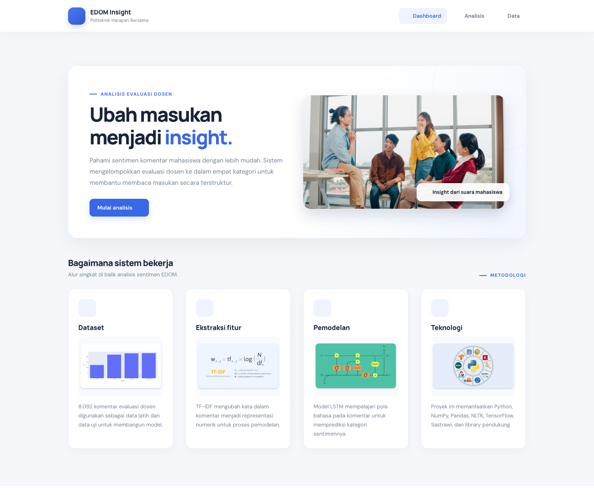

# SI Huawei Projek Akhir — Analisis Sentimen EDOM

Aplikasi web Flask untuk menganalisis komentar evaluasi dosen (EDOM) menggunakan model LSTM. Komentar diklasifikasikan ke dalam empat kategori: **Kurang**, **Cukup**, **Baik**, dan **Sangat Baik**.

## Tampilan aplikasi



## Fitur

- Menganalisis komentar mahasiswa berdasarkan dosen dan semester.
- Menampilkan kategori sentimen beserta ilustrasinya.
- Menyimpan dan menampilkan rekap hasil analisis.

## Menjalankan aplikasi

Proyek ini menggunakan dependensi TensorFlow dan Flask versi lama. Gunakan versi Python yang kompatibel dengan paket pada `requirements.txt`.

```bash
python3 -m venv .venv
source .venv/bin/activate
python -m pip install --upgrade pip
pip install -r requirements.txt
python app.py
```

Di Windows, aktifkan virtual environment dengan:

```powershell
.venv\Scripts\Activate.ps1
```

Setelah server berjalan, buka alamat lokal yang ditampilkan di terminal (biasanya `http://127.0.0.1:5000`).

## Berkas model

Aplikasi memuat `best_model.h5` dan `tokenizer1.pickle` dari direktori proyek. Pastikan kedua berkas tersebut tersedia sebelum menjalankan aplikasi.
